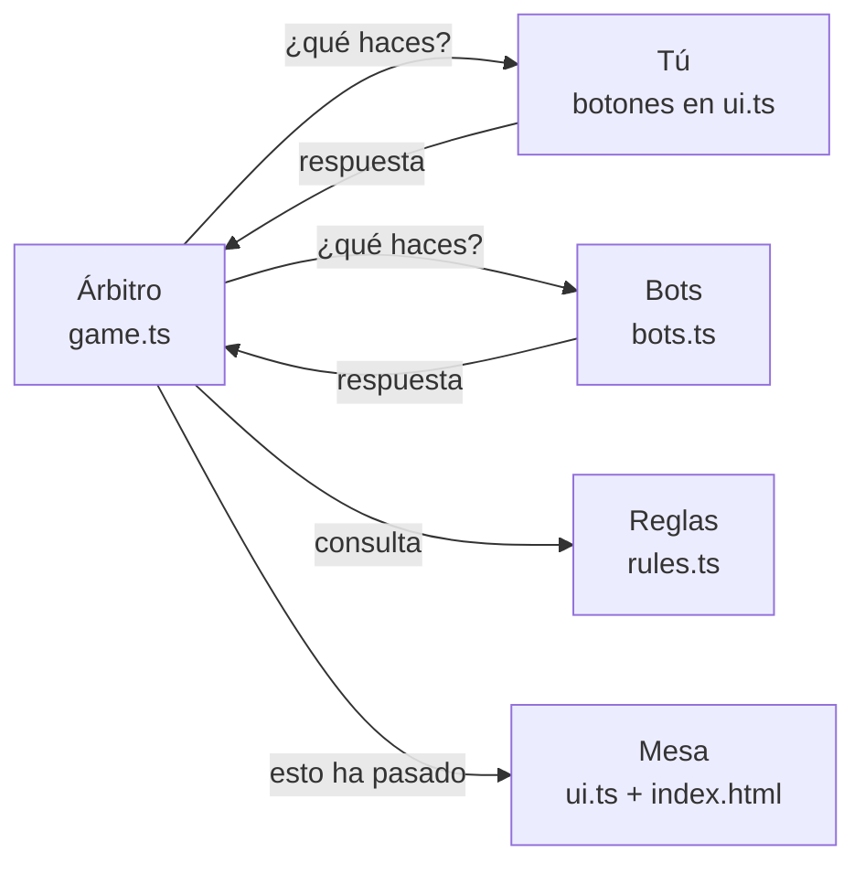

# Cómo funciona el código del Mus

Esta guía explica cómo está hecho el juego para alguien que conoce el mus pero no TypeScript.
No hace falta leerla entera: el **mapa de archivos** y las **recetas** del final bastan para
cambiar cosas sencillas.

---

## 1. La idea general

El juego está dividido en cuatro partes que se pasan información entre sí, como en una
partida de verdad:

| Parte | En la vida real | Archivo |
|---|---|---|
| **Las reglas** | Saber qué mano gana a cuál | `src/rules.ts` |
| **El árbitro** | Repartir, dar la palabra, apuntar los tantos | `src/game.ts` |
| **Los jugadores** | Tú (con botones) y los tres bots | `src/ui.ts` (tú) y `src/bots.ts` (bots) |
| **La mesa** | Lo que ves: cartas, marcador, botones | `index.html` y `src/ui.ts` |



La idea clave es que **el árbitro no sabe quién es humano y quién es bot**. A todos les
pregunta lo mismo («¿mus o no hay mus?», «¿envidas?») y espera la respuesta. Al bot le
contesta un cálculo y a ti te contesta un botón. Por eso las reglas se pueden probar haciendo
jugar a cuatro bots entre ellos (lo hace un test con 200 partidas).

---

## 2. Mapa de archivos

```
mus/
├── src/                  El código del juego (TypeScript)
│   ├── cards.ts          La baraja: palos, números, barajar, valor de cada carta
│   ├── rules.ts          Comparar manos: grande, chica, pares, juego y punto
│   ├── game.ts           El árbitro: desarrollo de una mano completa
│   ├── bots.ts           Cómo deciden los bots y qué señas hace tu compañero
│   ├── ui.ts             La mesa en pantalla y tus botones
│   ├── menu.ts           Menú de inicio, reglas, ajustes y fin de partida
│   ├── settings.ts       Ajustes y partidas ganadas, guardados en el dispositivo
│   └── main.ts           El arranque: conecta todo y empieza las partidas
├── index.html            La estructura de la página y TODOS los estilos (colores, tamaños)
├── test/                 Pruebas automáticas de las reglas
├── assets/cards/         Las 40 cartas y el reverso (imágenes .webp)
├── pwa/                  Lo que hace falta para instalarlo como app (icono, modo sin conexión)
├── build.mjs             El script que lo empaqueta todo
├── docs/                 El resultado empaquetado que publica GitHub Pages (no se edita a mano)
└── dist/mus.html         El mismo juego en un solo archivo, para Claude (no se edita a mano)
```

**Regla de oro:** se edita `src/`, `index.html`, `assets/` y `pwa/`. Las carpetas `docs/` y
`dist/` se regeneran solas con `npm run build`.

---

## 3. TypeScript en cinco minutos

TypeScript es JavaScript (el lenguaje de las páginas web) con una ayuda extra: se indica
**de qué tipo es cada cosa** para que el ordenador avise si te equivocas. El navegador no
entiende TypeScript; `build.mjs` lo traduce a JavaScript antes de publicarlo.

Esto es lo mínimo para leer el código. Todos los ejemplos son del propio juego.

### Constantes y funciones

```ts
const NUMBERS = [1, 2, 3, 4, 5, 6, 7, 10, 11, 12];   // una lista que no cambia

function points(c: Card): number {                  // recibe una carta, devuelve un número
  const r = rank(c);
  return r >= 10 ? 10 : r;                          // "si r ≥ 10 entonces 10, si no r"
}
```

- `const` guarda un valor con nombre. `let` es lo mismo pero se puede cambiar después.
- `c: Card` quiere decir «`c` es una carta». `: number` tras los paréntesis es lo que devuelve.
- `condición ? A : B` es un «si… entonces A, si no B» en una línea.

### Funciones flecha

Es otra forma de escribir funciones cortas:

```ts
export const team = (seat: number) => seat % 2;   // pareja de un asiento: 0 = nosotros, 1 = ellos
```

`seat % 2` es el resto de dividir entre 2: los asientos 0 y 2 dan 0, y los 1 y 3 dan 1.

### Tipos: describir la forma de los datos

```ts
export type Suit = 'oros' | 'copas' | 'espadas' | 'bastos';   // solo puede ser uno de estos cuatro
export interface Card { n: number; suit: Suit }               // una carta tiene número y palo
```

- `type` e `interface` no hacen nada por sí mismos: solo describen cómo es un dato.
- La barra `|` significa «o». Un palo es oros **o** copas **o** espadas **o** bastos.

Un caso que se usa mucho en el juego son las opciones con «etiqueta»:

```ts
export type Bet = { kind: 'paso' } | { kind: 'envido'; amount: number } | { kind: 'ordago' };
```

Una apuesta es pasar, envidar una cantidad o echar órdago. El campo `kind` dice cuál de las
tres es, y solo el envido lleva `amount` (la cantidad).

### Listas y sus herramientas

```ts
h.map(rank)                         // transforma cada carta en su valor: [12, 7, 7, 1]
rs.filter(r => r === 12).length     // cuántos reyes hay
h.reduce((s, c) => s + points(c), 0) // suma de puntos de la mano
```

- `===` es «es igual a» y `!==` es «es distinto de».
- `r => r === 12` es una función flecha pequeña: «para cada `r`, ¿es un rey?».

### Textos con huecos

```ts
`Envido ${b.amount}`     // con amount = 5 da "Envido 5"
```

Las comillas invertidas (`` ` ``) permiten meter valores dentro de un texto con `${ }`.

### Clases

Una clase es una plantilla con datos y funciones juntos. `Game` (el árbitro), `Bot`, `Ui`
(la mesa) y `Menu` son clases:

```ts
export class Bot implements Agent {
  senasOn = true;                       // un dato del bot
  async mus(_seat: number, h: Card[]) { … }   // una de sus decisiones
}
```

`implements Agent` significa «este bot cumple el contrato de jugador», es decir, sabe
responder a todas las preguntas del árbitro (ver la sección 6).

### Esperar respuestas: `async` y `await`

Es lo más importante para entender el juego. El árbitro pregunta y **espera** a que
contestes, que puede tardar segundos o minutos:

```ts
const mus = await this.ask(s, a => a.mus(s, this.hands[s]));
```

- `await` = «espera aquí hasta que llegue la respuesta». Mientras tanto, la pantalla sigue
  funcionando con normalidad.
- Una función que usa `await` se marca como `async`.
- Lo que devuelve una función `async` se llama **promesa** (`Promise`): una respuesta que
  llegará más adelante.

### Atajos con interrogación

```ts
this.agents[partner].senas?.(hand) ?? []
```

- `?.` = «solo si existe». Si este jugador no sabe hacer señas, no da error.
- `??` = «si no hay nada, usa esto otro». Aquí, una lista vacía.

### `export` e `import`

Cada archivo comparte lo que marca con `export`, y los demás lo traen con `import`:

```ts
import { pares, total, hasJuego } from './rules.ts';
```

---

## 4. Las cartas y los asientos

**Cartas** (`cards.ts`). Cada carta es `{ n, suit }`, por ejemplo `{ n: 12, suit: 'oros' }`.
Con 8 reyes, la función `rank` dice lo que **vale** cada carta en el juego:

- un 3 vale como rey (12),
- un 2 vale como as (1),
- el resto vale su número.

`points` da su valor para el juego y el punto: las figuras (10, 11, 12) valen 10.

**Asientos** (`game.ts`). Los jugadores se numeran del 0 al 3 en el orden en que hablan:

| Asiento | Quién | Pareja |
|---|---|---|
| 0 | Tú | Nosotros (0) |
| 1 | Derecha | Ellos (1) |
| 2 | Compañero | Nosotros (0) |
| 3 | Izquierda | Ellos (1) |

---

## 5. Las reglas: quién gana cada lance (`rules.ts`)

Todas las funciones de comparación siguen el mismo convenio: reciben dos manos `a` y `b`,
y devuelven **un número positivo si gana `a`**, negativo si gana `b` y 0 si empatan.
Los empates los resuelve el árbitro: gana quien esté más cerca de la mano.

| Función | Cómo compara |
|---|---|
| `cmpGrande` | Ordena cada mano de mayor a menor y compara carta a carta. |
| `cmpChica` | Igual, pero de menor a mayor, y gana la más baja. |
| `pares` y `cmpPares` | Detecta pareja (1), medias (2) o duples (3); a igual tipo, gana la figura más alta. |
| `cmpJuego` | Sigue el orden 31, 32, 40, 37, 36, 35, 34, 33. |
| `cmpPunto` | Gana el total más alto (el más cercano a 30). |

`juegoValue` da los puntos del juego (3 por 31 y 2 por los demás). El valor de los pares
es su propio tipo: 1, 2 o 3.

---

## 6. El árbitro: una mano paso a paso (`game.ts`)

La clase `Game` guarda el estado de la partida: tanteo (`scores`), quién es mano (`mano`),
las cartas de cada uno (`hands`) y cómo ha ido cada lance (`results`).

Toda la mano está en la función `playHand()`, que lee casi como un guion:

1. **Rotar la mano** al siguiente jugador (salvo en la primera mano).
2. **Repartir** 4 cartas a cada uno.
3. **`musPhase()`**: cada uno, empezando por la mano, dice mus o no hay mus. Si todos piden
   mus, cada uno se descarta (`discard`) y se repite.
4. **`partnerSenas()`**: tu compañero te hace señas (o no).
5. **`playLance('grande')`** y **`playLance('chica')`**.
6. **`declareAndPlay()`**: cada uno dice si tiene pares y se juega el lance de pares con los
   que tienen; luego lo mismo con el juego. Si nadie tiene juego, se juega al punto.
7. **`score()`**: el recuento. Suma los puntos de cada lance y devuelve las frases que ves
   en el resumen de la mano.

### Los envites (`playLance` y `envite`)

En cada lance, el árbitro da la palabra por orden. Si todos pasan, el lance queda «en paso».
Si alguien envida, entra en `envite()`, que es un bucle de ida y vuelta:

- **Quiero**: el envite queda aceptado y se cobra en el recuento.
- **No quiero**: quien envidó cobra en el acto. Cobra 1 si era el primer envite, o lo que ya
  estaba aceptado antes de la última subida (la variable `prev`).
- **Subir**: se acepta lo anterior, se suma la subida y la palabra pasa a la otra pareja.
- **Órdago querido**: se enseñan las cartas y quien gana ese lance gana la partida.

### Cómo acaba la partida

Cuando una pareja llega a los puntos de la partida (40 por defecto), o se gana un órdago,
el árbitro lanza un aviso especial llamado `GameOver`. Es como gritar «¡se acabó!»: corta
la mano en el momento, aunque esté a medias.

### El contrato de los jugadores (`Agent`)

```ts
export interface Agent {
  mus(seat, hand): Promise<boolean>;      // ¿mus? (sí o no)
  discard(seat, hand): Promise<number[]>; // qué cartas tiras (sus posiciones)
  bet(ctx): Promise<Bet>;                 // ¿pasas, envidas u órdago?
  reply(ctx): Promise<Reply>;             // ¿quiero, no quiero, subes u órdago?
  senas?(hand): Sena[];                   // señas (opcional)
}
```

`Bot` (en `bots.ts`) y `Human` (en `ui.ts`) cumplen este contrato. El bot calcula la
respuesta; `Human` enseña botones y espera a que pulses uno.

### Avisos a la mesa (`Events`)

El árbitro también avisa a la pantalla de lo que pasa: `say` (alguien habla), `signal`
(una seña), `newHand` (mano nueva) y `update` (repinta la mesa). La pantalla no decide nada:
solo enseña lo que el árbitro le cuenta.

---

## 7. Cómo piensan los bots (`bots.ts`)

### La fuerza de una mano

`strength(lance, mano)` da una nota de 0 a 1 para cada lance. Por ejemplo, en grande cada rey
suma 0,27, así que tres reyes ya dan más de 0,8. La chuleta que ves debajo de tus cartas
usa esta misma nota: **buena** (0,7 o más), **regular** (0,45 o más) o **floja**.

### Sus decisiones

| Decisión | Cómo la toma |
|---|---|
| **Mus** | Corta si tiene 31, medias o duples, tres reyes, o pareja de figuras con juego. |
| **Descarte** | Se queda con reyes, ases y las cartas que forman pares, y tira el resto. |
| **Envidar** | Con nota > 0,9 echa órdago una de cada cinco veces. Con nota > 0,6 envida (más cuanto mejor). Un 8 % de las veces se tira un farol. |
| **Responder** | Quiere si su nota supera un listón que sube con la apuesta (0,42 más 0,025 por cada tanto). Con mucha ventaja a veces sube 2, y con nota > 0,92 a veces echa órdago. A un órdago solo dice quiero con nota > 0,82. |

### Las señas

`senasFor(mano)` mira la mano y devuelve todas las señas que encajan, de la más importante
a la menos (31, duples, medias, tres reyes, dos reyes, tres ases, dos ases, ciego).
El compañero hace seña en un 65 % de las manos, y a veces hace dos.

---

## 8. La pantalla

### `index.html`: la estructura y el aspecto

Tiene dos partes:

1. **Los estilos** (entre `<style>` y `</style>`): colores, tamaños y posiciones. Al principio
   están las **variables de color**, por ejemplo `--us` (amarillo de nuestra pareja) y
   `--them` (salmón de los rivales). Cambiando una variable cambia en todo el juego.
2. **Las piezas de la página**: cabecera con el marcador, la mesa con los cuatro asientos,
   la barra de botones y las pantallas de menú, reglas, ajustes y fin de partida. El texto de
   «Cómo se juega» está escrito aquí directamente.

Los diseños de cada tipo de pantalla están en bloques que empiezan por `@media`:

| Bloque | Cuándo se aplica |
|---|---|
| (sin `@media`) | iPad y pantallas grandes |
| `@media (max-width: 600px), (max-height: 500px)` | Cualquier móvil: bots como fichas, lance grande, chuleta plegable |
| `@media (max-width: 600px)` | iPhone en vertical |
| `@media (max-height: 500px) and (orientation: landscape)` | iPhone en horizontal |

### `ui.ts`: dar vida a la mesa

- **`update()`** repinta la mesa entera con el estado actual del árbitro: marcador, cartas,
  quién es mano, de quién es el turno, lances, chuleta… Se llama cada vez que algo cambia.
- **`say()`** y **`signal()`** muestran lo que dice cada jugador (burbujas y frases) y hacen
  la pausa de los bots.
- **`choose()`** pinta los botones de una pregunta, enciende el aviso de «TE TOCA» y espera
  a que pulses uno. **`pickDiscards()`** hace lo mismo para elegir descartes.
- **`showSummary()`** enseña el recuento de la mano.
- La clase **`Human`** traduce cada pregunta del árbitro en botones: «Mus / No hay mus»,
  «Paso / Envido / Envido 5 / Órdago», etc.

### Pausar y abandonar partidas

Al abrir el menú se llama a `pause()` y los bots se quedan esperando hasta `unpause()`.
Cuando empiezas una partida nueva con otra a medias, `newSession()` sube un contador
(`gen`, de «generación»). La partida vieja comprueba ese número cada vez que habla; si ya
no es el suyo, se detiene con un aviso `Abort`. Así nunca hay dos partidas a la vez.

### `menu.ts`, `settings.ts` y `main.ts`

- **`menu.ts`** maneja las pantallas fuera de la mesa: el abanico de reyes, los botones del
  menú, el formulario de ajustes y la pantalla de victoria o derrota.
- **`settings.ts`** guarda los ajustes y las partidas ganadas y perdidas en el propio
  dispositivo (`localStorage`). Si el navegador no deja guardar, por ejemplo en modo
  privado, el juego funciona igual pero no recuerda nada.
- **`main.ts`** es el punto de arranque: crea la mesa y el menú, y con `startGame()` monta
  una partida (tú, dos bots rivales y el bot compañero), la juega mano a mano y al final
  enseña el resultado.

---

## 9. Empaquetar y publicar (`build.mjs`)

`npm run build` ejecuta `build.mjs`, que:

1. Traduce todo `src/` de TypeScript a JavaScript y lo junta en un único bloque (con la
   herramienta **esbuild**).
2. Convierte las 41 imágenes de `assets/cards/` en texto (base64) y las mete dentro de la
   página, en una variable llamada `__CARDS__`. Por eso el juego es un único archivo que
   funciona sin descargar nada más.
3. Escribe dos versiones:
   - `dist/mus.html`: para publicar en Claude.
   - `docs/index.html`, más el icono, `manifest.webmanifest` y `sw.js`: para GitHub Pages.

### Cómo funciona sin conexión

`sw.js` es un **service worker**: un pequeño programa que el navegador instala la primera
vez que abres el juego y que guarda una copia de todo. Cada vez que abres el juego intenta
descargar la versión nueva; si no hay conexión, usa la copia guardada. Cada build lleva un
número de versión distinto, y así el iPhone sabe cuándo tiene que actualizar.

### Publicar

GitHub Pages publica automáticamente la carpeta `docs/` del repositorio. Para publicar un
cambio:

```bash
npm run build
git add -A
git commit -m "Describe el cambio"
git push
```

En uno o dos minutos está en https://pedroalg.github.io/mus/. En el iPhone o el iPad hay que
abrir la app dos veces seguidas: la primera descarga la versión nueva y la segunda la muestra.

---

## 10. Pruebas automáticas (`test/`)

```bash
npm test
```

- `rules.test.ts`: comprueba las comparaciones (por ejemplo, que el 3 cuenta como rey, o que
  31 gana a 32 y 32 a 40).
- `senas.test.ts`: comprueba que cada mano da la seña correcta.
- `game.test.ts`: juega 200 partidas completas entre cuatro bots y comprueba que todas
  terminan sin errores.

Conviene pasarlas antes de publicar si has tocado `rules.ts`, `game.ts` o `bots.ts`.

---

## 11. Recetas: cambios habituales

Después de cualquier cambio, ejecuta `npm run build` y publica (sección 9).

**Cambiar los ajustes por defecto** (por ejemplo, partida a 30 o bots más lentos):
en `src/settings.ts`, la línea `const DEFAULTS`. Las pausas de cada velocidad están en
`BOT_DELAY`, en milisegundos (1.000 = un segundo).

**Bots más atrevidos o más prudentes**: en `src/bots.ts`, funciones `bet` y `reply`.
Bajar el `0.6` de `bet` hace que envíen más; subir el `0.42` de `reply` hace que acepten menos.

**Más o menos señas del compañero**: en `src/bots.ts`, función `senas`. El `0.35` es la
probabilidad de **no** hacer seña.

**Añadir o cambiar una seña**: en `src/bots.ts`, función `senasFor`. Cada línea es una seña
con su cara, su gesto y su significado. Acuérdate de actualizar también la tabla de señas
de «Cómo se juega» en `index.html` y el test `test/senas.test.ts`.

**Cambiar colores**: en `index.html`, el bloque `:root { … }` del principio.
`--felt` es el verde del tapete, `--us` el amarillo de vuestra pareja, `--them` el salmón
de los rivales y `--gold` el dorado de la mano y del turno.

**Cambiar el tamaño de las cartas**: en `index.html`, la variable `--cw` (tus cartas) y
`--cw-side` (las de los bots). Cada tipo de pantalla tiene su propio valor dentro de su
bloque `@media`.

**Cambiar el texto de las reglas**: en `index.html`, dentro de `<section … id="rules">`.

**Volver a retocar las cartas**: las imágenes originales vienen de la baraja de Heraclio
Fournier de 1878 en Wikimedia Commons (dominio público). Para cada carta descargada a
1.280 px se usó ImageMagick y cwebp:

```bash
magick original.png -wavelet-denoise 4% -filter Lanczos -resize 500x \
  -channel R -level 7%,96% -channel G -level 7%,91% -channel B -level 7%,80% +channel \
  -modulate 100,122 -unsharp 0x1.0+1.2+0.02 retocada.png
cwebp -q 78 -alpha_q 85 -sharp_yuv retocada.png -o assets/cards/oros-12.webp
```

Los nombres son `palo-número.webp` (por ejemplo `copas-7.webp` o `espadas-10.webp`), más
`back.webp` para el reverso.

---

## 12. Glosario

| Término | Qué es |
|---|---|
| **TypeScript** | JavaScript con tipos. Se traduce a JavaScript antes de publicarse. |
| **Tipo** | La descripción de cómo es un dato (una carta, una apuesta…). |
| **Función** | Un trozo de código con nombre que recibe datos y devuelve un resultado. |
| **Clase** | Una plantilla que junta datos y funciones (el árbitro, un bot, la mesa). |
| **Promesa / `await`** | Una respuesta que llegará más tarde, y la forma de esperarla. |
| **`export` / `import`** | Compartir algo de un archivo y usarlo en otro. |
| **esbuild** | La herramienta que traduce y junta el código. |
| **npm** | El gestor de herramientas de JavaScript (`npm install`, `npm test`…). |
| **Service worker** | El programa que guarda el juego para usarlo sin conexión. |
| **PWA** | Página web que se instala como app en la pantalla de inicio. |
| **GitHub Pages** | El servicio gratuito de GitHub que publica la carpeta `docs/` como web. |
| **`localStorage`** | Un pequeño almacén del navegador donde se guardan los ajustes. |
| **base64** | Una forma de convertir una imagen en texto para meterla dentro de la página. |
